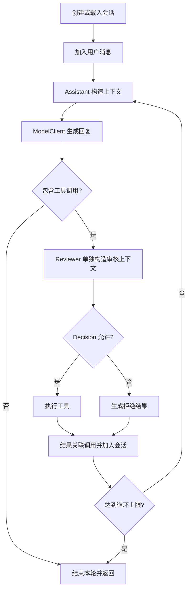

# 视频精华与时间轴

来源：[Hucci写代码《10分钟学会设计 Agent 架构》](https://www.bilibili.com/video/BV1winH6DEgt/)。本文根据实际下载视频的烧录字幕与架构图概括，方法与限制见[来源记录](素材/视频来源与提取记录.md)。以下对象名来自画面，说明采用重新归纳的表述。

## 1. 视频要解决的核心问题

作者借一个可续聊、可调用工具的 Agent 后端，讲如何让模型、存储、入口可以替换，并让核心流程能够使用假依赖测试。重点是领域建模、依赖倒置和组装，不是介绍某个 Agent 框架的功能大全。

开头涉及的 harness，可理解为围绕模型组织上下文、执行工具、保存状态及约束循环的外部程序。视频没有给出覆盖全部生产治理能力的 harness 规范。

## 2. 时间轴与内容定位

| 时间段（约） | 视频内容 | 可提炼的设计要点 |
| --- | --- | --- |
| 00:00–00:24 | 多模型、安全执行与可扩展性问题 | 循环之外，还要设计与外部系统打交道的边界。 |
| 00:25–01:07 | 一轮对话流程 | 上下文 → 模型 → 审核工具 → 执行/拒绝 → 结果回流，设循环上限并保存消息。 |
| 01:08–02:52 | 三层及其动机 | 领域定义自己的概念，应用编排，适配层翻译外部协议。 |
| 02:55–04:06 | 会话与消息建模 | 用 Session 和消息类型表示历史，用调用 ID 关联工具结果。 |
| 04:09–05:03 | SessionStore | 应用声明所需存储接口，JSONL 只是其中一种适配。 |
| 05:05–05:43 | Tool 与 BashTool | 工具同时包含面向模型的描述和面向程序的执行能力。 |
| 05:45–06:30 | Context 泛型 | 任务输入与预期输出显式化，复用同一类上下文容器。 |
| 06:32–07:33 | ModelClient 与协议适配 | 隔离不同厂商的请求格式、输出和思考参数。 |
| 07:34–08:30 | Assistant、Reviewer、Decision | 不同任务分别构造上下文；审核角色没有工具。 |
| 08:34–09:22 | AgentService | 集中编排，角色可使用不同模型设置，HTTP/CLI 不进入核心用例。 |
| 09:24–09:58 | 组装根与目录 | 在启动处创建具体实现并注入接口。 |
| 10:00–10:31 | 交给 AI 实现与测试 | 先约束接口，再结合测试实现；质量保证程度见下一篇分析。 |
| 10:32–11:13 | 两个练习 | 对话分叉和压缩只提出需求，没有完整方案。 |

## 3. 核心循环的提炼

视频还要求消息产生时保存。图为本报告重绘；没有补入视频未给出的事务、异常恢复或安全沙箱。

值得保留的是：工具结果是后续决策的输入；拒绝也是一种明确结果；审核与正常回答可以使用不同任务上下文。这里的“两个角色”不能直接等同于完整多 Agent 协作系统。

## 4. 对象与职责

| 对象 / 接口 | 视频赋予的职责 | 所在位置 |
| --- | --- | --- |
| `Session` | 对话标识、消息序列及追加消息 | 领域层 |
| `UserMessage` / `AssistantMessage` | 用户文本；助手文本与工具调用 | 领域层 |
| `ToolCall` / `ToolResult` | 工具名、参数及调用标识；关联该标识的结果 | 领域层 |
| `Tool` | 名称、用途、参数定义及执行接口 | 领域层的抽象；具体工具在适配层 |
| `Context[O]` | 指令、工具、消息、预期输出类型 | 领域层 |
| `Assistant` / `ToolCallReviewer` | 分别生成回答上下文、审核上下文 | 领域层 |
| `Decision` | 允许与否及拒绝理由 | 领域层 |
| `SessionStore` | 列出、保存、载入会话 | 应用层端口 |
| `ModelClient` | 根据 Context 与模型设置生成预期类型的结果 | 应用层端口 |
| `ModelSettings` / `Effort` | 模型身份与内部思考档位 | 应用层 |
| `AgentService` | 用上述接口组织一轮对话及工具循环 | 应用层 |
| JSONL 存储、厂商 Client、Bash、Web API | 把具体技术翻译成内部概念，或把外部请求转成用例调用 | 适配层 |
| `main.py` | 创建对象、注入依赖、启动服务 | 组装根 |

`Context[O]` 表达“这次调用想得到什么”，不是对运行结果的自动证明。视频为审核角色推荐更便宜、更快的模型，属于可尝试的配置，不是已经证明安全有效的结论。

## 5. 分层思想如何理解

三层与组装根对应四个问题：

1. **领域：**我们处理哪些概念，它们有何规则？
2. **应用：**为完成一次用户请求，按什么顺序使用这些概念？
3. **适配：**文件、数据库、模型协议、HTTP 如何与内部概念转换？
4. **组装：**本次部署选择哪些具体实现，如何接起来？

依赖方向的关键是：应用用例依赖自己需要的接口，具体适配器满足接口；不让用例依赖某家模型 SDK 或某种文件格式。HTTP 也是适配器，只是请求方向与模型、存储相反。

视频画面最终目录包含 `domain/{session,context,tool,roles}.py`、`app/{ports,service}.py`、`adapters/{models,stores,api,tools}/` 和 `main.py`。它是展示职责的示例，不要求所有项目照抄目录名，也没有要求拆成三个微服务。

## 6. 视频留给读者的练习

**分叉对话：**从某条历史消息创建新分支，保留截至该位置的上下文，后续独立演进。

**对话压缩：**把较旧的历史汇总为摘要，后续输入使用摘要加近期消息，降低长会话开销。

这两项在片尾约 10:41–11:06 被提出，没有给出消息版本、分支引用、摘要失真处理等实现。不能把它们记为视频已经完成的能力；[补全设计](04-补全后的Agent设计与项目分层.md)提供独立建议。
