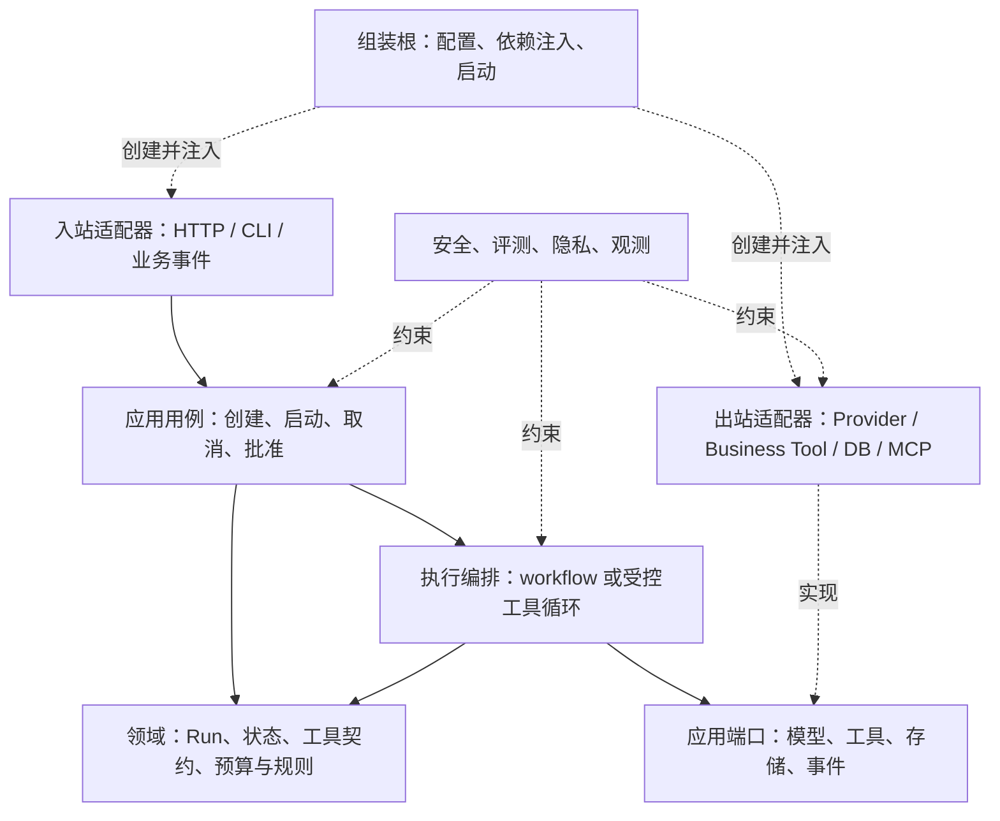

# 补全后的 Agent 设计与项目分层

本文是基于视频方法形成的**独立设计建议**，不是视频转录，也不表示 com-agent-runtime 已实施下述全部能力。一手依据见[03](03-Agent设计一手资料与核验依据.md)，com 的实际映射见[05](05-与com-agent-runtime对照及优化计划.md)。

## 1. 从成功结果开始，而不是从循环开始

先写清五件事：输入和受信来源、需要交付的产物、确定性的业务规则、允许使用的能力、成功与失败的判据。

例如回忆录任务：输入是业务后端冻结的素材快照定位参数；输出是已校验并原子发布的作品引用；素材权限、发布所有权和当前版本由业务后端保证；模型负责选择和表达，不能决定身份、发布目标或授权范围。最终验收看业务发布状态与引用，而非模型说“已完成”。

然后选控制方式：固定流程可覆盖时用 workflow；下一步确实需要模型选择时使用受控工具循环；固定主流程内局部不确定时采用混合方式。选择依据是任务收益、成本和错误后果。长期记忆、RAG、多 Agent、MCP 分别解决特定问题，按需求增加。

## 2. 核心概念必须分清

| 概念 | 含义 | 不宜混同的对象 |
| --- | --- | --- |
| Session / Conversation | 用户互动与历史分支 | 一次后台运行可能只是会话中的一个任务。 |
| AgentDefinition / Package | 版本化任务定义、工具与策略 | 不等于一次执行的可变状态。 |
| Run | 一次业务目标的执行和最终结果 | 不等于消息列表，也不等于 Worker attempt。 |
| Step / Attempt | 步骤及其物理执行次数 | 物理重试不应改变同一业务动作的幂等身份。 |
| Context | 本次模型可见的信息投影 | 不等于全部历史、完整数据库或长期记忆。 |
| Checkpoint | 恢复执行所需的受控状态 | 不要求保存全部原始内容；按业务可只存引用与进度。 |
| Artifact | 可交付产物或其引用 | 不等于调试日志，也不一定由 Runtime 持有权威正文。 |
| Memory | 按准入策略保留、可检索的经验或事实 | 历史自动追加到文件不等于高质量长期记忆。 |

会话式 Agent 可以把 Session 放在前台主模型；任务平台可把 Run 放在后台主模型。需要两者时，通过明确关联连接，而不是把聊天消息表扩展成所有运行事实的唯一来源。

## 3. 保留三层，再明确横向职责



上图是职责与依赖关系，不是部署拓扑。小项目可以在一个进程内实现，不必先建设插件平台。

| 边界 | 放什么 | 应避免什么 |
| --- | --- | --- |
| 领域 | 状态转换、结果类型、工具语义、预算规则和不变量 | 直接依赖厂商 SDK、HTTP Request 或某个数据库连接。 |
| 应用 | 用例、编排、端口、事务边界与授权策略调用 | 把状态变化散落到路由或提示词中。 |
| 入站适配 | 认证接入、请求/命令映射、响应投影 | 自己复制一套任务业务逻辑。 |
| 出站适配 | 协议编码、受控网络请求、持久化与错误映射 | 通过模型参数改变可信 endpoint、身份或权限。 |
| 组装根 | 创建具体对象，按配置选择实现 | 在普通用例内部偷偷创建真实模型或数据库。 |
| 横向治理 | 授权、隐私、观测、评测、预算和部署约束 | 做成任何流程都能绕过的可选装饰器。 |

领域层可声明工具能力抽象，但实际执行仍经受控端口和适配器。目录分开只是辅助，测试应证明依赖可以替换、关键约束无法绕过。

## 4. 一个可演进的示例目录

以下是新项目参考，**不是要求重排 com 的目录**：

```text
agent_backend/
  domain/                 # Run、消息/事件、工具契约、状态和结果
  application/
    use_cases/            # create/start/cancel/approve
    execution/            # workflow、受控 loop、恢复策略
    ports/                # model、tool、repository、event
    context/              # 信息选取、压缩、来源与预算
    policies/             # 授权、预算、风险分级
  adapters/
    inbound/              # HTTP、CLI、事件 consumer
    models/               # 具体模型协议及能力映射
    tools/                # 业务 HTTP、窄工具；按需 MCP/沙箱
    persistence/          # Run、事件、checkpoint、幂等记录
    telemetry/            # 安全指标与 trace exporter
  agents/<agent>/<version>/
                            # 图/策略、prompt、schema、evals
  bootstrap/              # 组装根与可信注册表
  tests/                  # 单元、协议、任务评测与故障场景
```

只存在一种实现且没有替换需求时，不必为每个类增加一层工厂。通过第二种真实需求检验抽象，通常比提前设计一套通用 DSL 更稳妥。

## 5. 执行闭环：为每次外部动作定义边界

1. **接入：**认证、资源授权、输入校验和幂等去重，冻结任务定义与安全配置，返回 Run ID。
2. **调度：**需要后台执行时持久化调度意图；认领者取得单写者凭据，支持取消与容量限制。
3. **构造上下文：**只取当前获授权的数据；可信指令与不可信材料分离；保留来源、按模型窗口计预算。
4. **模型决策：**能力预检后发出请求；解析停止原因、结构化结果、工具调用和用量，区分协议失败与业务失败。
5. **执行前门禁：**确定性校验工具/参数/目标/权限/预算；必要时模型审核或人审；实际发送前重新检查授权、取消与执行所有权。
6. **动作与观察：**有界执行，规范化结果与错误；写操作使用稳定逻辑幂等键。结果未知时先查询确认，再决定是否重发。
7. **评价与保存：**独立验证业务约束；保存允许持久化的进度和安全摘要，确定下一步、降级或结束。
8. **交付：**区分成功、部分成功、失败、取消及等待人工；可靠通知业务方，验证业务方已拥有可用结果。

并非所有任务都必须使用数据库 lease。短生命周期、单进程只读任务可简化；多 Worker、长任务和外部写操作则需要相应一致性方案。不能把内存循环的保证直接外推到多进程服务。

### 副作用重试的例子

```text
工具发布作品成功
  -> 响应丢失 / Worker 崩溃
  -> 新 attempt 恢复
  -> 用原来的逻辑操作键查询发布结果
  -> 已提交：复用结果；确定未提交：按策略重试；未知：继续对账或转人工
```

幂等身份属于业务逻辑动作，不应使用每次变化的 attempt ID 重新生成。跨服务更实用的承诺是至少一次交付配合幂等效果，而不是笼统保证 exactly-once。

## 6. 工具和模型端口需要表达哪些语义

**工具定义**至少区分：输入/输出 schema、只读或副作用、授权范围、超时、取消语义、幂等与结果查询方式。模型只能提供候选业务参数；tenant、身份、connector、endpoint、审批凭据和幂等键从可信上下文取得。

**工具结果**区分成功、拒绝、可重试失败、不可重试失败、提交未知，并保持 ToolCall 关联。错误只向模型暴露经过策略允许的信息；不要把底层异常与凭据原样返回。

**模型端口**区分逻辑策略、路由能力与具体协议。适配器统一共同语义，同时显式保留差异；能力不足时拒绝或执行声明过的降级。结果元数据应能承载停止原因、用量是否已知、结构化校验状态及工具调用；不需要把原始内容写入 trace。

流式请求在参数尚未完整且未通过门禁前，不执行半截工具调用；并行工具是否安全由独立性与副作用决定。协议支持并行，不代表业务允许并行。

## 7. 上下文、压缩和分叉的补全

### 7.1 上下文策略

一次模型输入是“受控投影”：固定指令、相关资料、当前工作进度、必要历史、受限工具描述。预留输出空间并统计所有输入组成，不能只计算用户文本。超窗时选择丢弃低相关资料、检索或压缩；保留来源与确定性业务事实，不能让摘要改写授权。

长期记忆额外需要准入、来源、作用域、过期、纠错和删除策略。未经授权把私密原文写入跨会话向量库，会扩大数据生命周期；不能因工具名叫 Memory 就免于治理。

### 7.2 对话压缩

把摘要视为带来源和覆盖范围的派生数据。记录覆盖的消息区间、摘要版本、生成策略，以及未完成工具调用等必须保留的状态。摘要失败或冲突时保持已有可信状态，使用允许的回退；无法安全恢复时明确失败。相关原文已依法或按用户要求删除时，不能通过摘要或备份偷偷复活。

验收包括：约束与任务目标未丢失、工具调用与结果不拆散、来源可追溯、预算确实下降、多次压缩后不累计关键错误。不要把“让模型总结”当作已经解决上下文管理。

### 7.3 对话分叉

需要稳定的消息/事件 ID 和父分支定位；分叉点应是完整事件边界，避免孤立工具结果。新分支取得当前授权并创建独立 Run/动作身份，不能复用旧审批或无条件重放父分支副作用。

历史可通过不可变前缀引用复用，或复制允许保留的视图；删除、访问范围与摘要继承规则需要定义。验收包括父子后续互不覆盖、分支鉴权、删除传播、并发分叉，以及从工具执行中间位置分叉时的拒绝/恢复语义。

## 8. 最小验收应覆盖什么

| 类别 | 有意义的验收例子 |
| --- | --- |
| 正常任务 | 输出符合 schema、来源和业务规则，环境中的最终产物可用。 |
| 模型协议 | 能力不支持、拒绝、截断、错误 JSON、未知用量、工具 ID 不匹配。 |
| 工具与授权 | 越权资源、注入文本、畸形参数、取消后发送、审批过期。 |
| 恢复一致性 | 工具已成功但响应丢失、重复调度、旧 Worker 迟到、恢复时授权被撤销。 |
| 上下文 | 长历史、压缩失真、删除后恢复、分叉隔离、超大工具返回。 |
| 治理与质量 | 无进展终止、费用/时间上限、主产物成功而增强失败、私密内容不进入可公开轨迹。 |

先跑便宜的确定性与协议测试，再用受控真实样本评测任务质量、延迟、费用和风险漏放。重复试验看稳定性；不能只选一次成功演示。测试替身证明隔离与控制流，不能替代真实供应商和生产发布验收。
