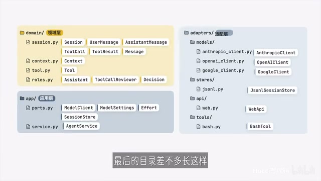

# 视频来源与提取记录

## 来源与下载结果

| 项目 | 记录 |
| --- | --- |
| 原页面 | [BV1winH6DEgt](https://www.bilibili.com/video/BV1winH6DEgt/) |
| 标题 / 作者 | 《10分钟学会设计 Agent 架构》 / Hucci写代码 |
| 发布时间 | 2026-10-23 17:00:00，Asia/Shanghai；来自公开视频元数据 |
| 采集日期 | 2026-10-27，Asia/Shanghai |
| aid / cid | `117485256907460` / `42962848554` |
| 页面时长 / 文件时长 | 673 秒 / 672.704 秒 |
| 本地文件 | [BV1winH6DEgt.mp4](BV1winH6DEgt.mp4)，本地保留，Git 忽略 |
| 字节数 | `10539823` |
| SHA-256 | `4eab400a3f19cfe2d894717e61d499af73b466487cd2686efdebd1ccbb410378` |
| 媒体 | MP4，H.264 640×360，AAC 音轨；公开播放接口此次返回清晰度 16 |

公开元数据由 `https://api.bilibili.com/x/web-interface/view?bvid=BV1winH6DEgt` 获取；字幕状态由 `/x/player/v2` 获取；视频经 `/x/player/playurl` 返回的公开视频地址下载。未使用账号登录或付费权限，也未保存临时播放签名 URL。

Web 阅读工具不能打开视频页，普通终端网络受限；随后通过经授权的网络访问获取成功。这些失败没有用搜索标题或简介代替视频内容。

## 提取方法与可信度

1. 使用 `ffprobe` 核验文件时长、编码和尺寸。
2. 使用 `ffmpeg -i <本地视频> -vf fps=1 -q:v 2 <临时目录>/%04d.jpg` 抽取 673 帧，覆盖全片时间范围。
3. 使用 macOS Vision 本地 OCR，语言为简体中文与英文；得到 673 个时间点的识别记录，672 帧含可识别文字。每帧保留文字位置，区分底部字幕和图内对象。
4. 连续读取字幕时间轴，并对流程、Context、模型设置、角色与最终目录等关键帧做视觉校对。字幕错字和小字号类名不直接当作事实；架构图与相邻字幕交叉确认。
5. 将内容整理为主题摘要，再分别进行技术评价和项目对照。

**限制：**不是平台字幕轨、独立音频转录或作者提供的源码。每秒采样可能遗漏极短字幕，小字号英文存在 OCR 错误；时间轴只用于定位，约有 1 秒误差。关于全片“未展开”的判断指本次可读字幕与画面中未形成方案，不证明作者在其他材料中没有设计。未检验视频所示代码能否执行，不能替作者做测试通过声明。

OCR 中间文件和大量帧保存在临时目录供本次校对，未作为持久交付；以下少量关键帧与原视频用于长期复核。

## 关键帧索引

| 视频位置（约） | 证据 |
| --- | --- |
| 00:44 | [工作流程](关键帧/00-44-工作流程.jpg) |
| 04:24 | [SessionStore 接口](关键帧/04-24-SessionStore接口.jpg) |
| 05:32 | [工具契约](关键帧/05-32-工具契约.jpg) |
| 06:27 | [Context 泛型](关键帧/06-27-Context泛型.jpg) |
| 06:59 | [模型设置](关键帧/06-59-模型设置.jpg) |
| 08:22 | [Reviewer 与 Decision](关键帧/08-22-Reviewer与Decision.jpg) |
| 09:57 | [最终目录](关键帧/09-57-最终目录.jpg) |

